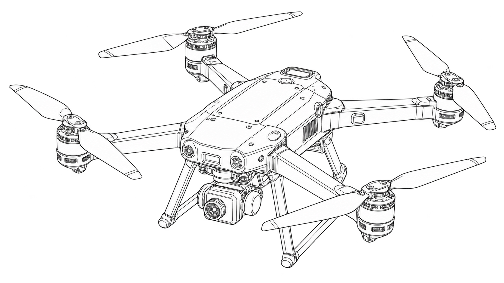
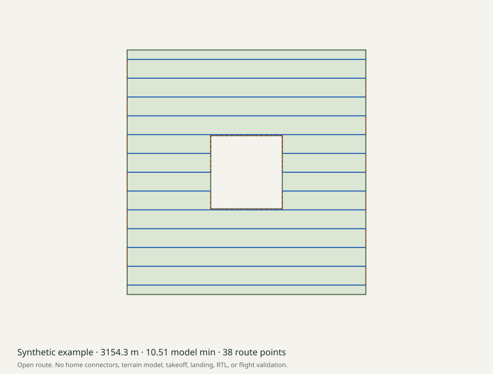

# Autonomous Drone Mission Planning



_Generated line-art concept illustration._

An offline survey workbench for a PIXHAWK mission study. Load or draw a polygon with holes, set explicit camera assumptions, inspect the complete route, and save JSON, GeoJSON, or a validated QGC WPL 110 waypoint file. No vehicle connection occurs.

The route is open. Home connectors, takeoff, landing, RTL, speed commands, and camera triggers are not generated. This is a planning and file-format implementation, not a flight-tested autopilot integration.

## Run locally

Use Node **22.18 or later** and npm. There are no runtime dependencies, API keys, map services, or global packages.

```sh
npm ci
npm run check
npm run dev
```

Open **http://127.0.0.1:8793/**. The browser processes local files and uses a local coordinate grid without map tiles. Add boundary and exclusion vertices with the pointer or explicit longitude/latitude fields. The coordinate editor is also available. Inputs changed after generation disable exports until regeneration.

Assumed camera AGL and waypoint height relative to home are separate inputs. Supply planned-home latitude, longitude, and **AMSL altitude** explicitly to save a waypoint file. The example home is synthetic fixture data; it is not a known elevation or a safe launch location.

## CLI

```sh
npm run build
node dist/src/cli.js plan examples/area-with-hole.geojson --settings examples/settings.json --home examples/home.json --out runs
node dist/src/cli.js check runs/survey.waypoints
```

`--out` must name a new directory. The CLI refuses to overwrite it. Omit `--home` to write only `plan.json` and `route.geojson`. The waypoint export contains a frame-0 planned-home row (AMSL), followed by frame-3 route points (relative to home). Syntax checking does not validate aircraft behaviour or source-polygon containment from the file alone.

## Actual fixture result



The committed [synthetic run](docs/demo/summary.json) contains one rectangular boundary and one exclusion. With the recorded camera settings, the planner produced **3,154.31 m**, **38 route points**, **16 survey legs**, **21 transit legs**, and **17.32 m sweep spacing**. At an assumed 5 m/s this is **10.51 model minutes**, or **42.06%** of a full nominal 25-minute duration. A 20% reserve leaves 20 usable minutes. These are calculations, not measured aircraft endurance.

```sh
npm run demo
```

This regenerates and compares all five committed artifacts byte-for-byte, including a semantic WPL round trip and generated altitude frames. See [the report](docs/demo/plan.json), [route GeoJSON](docs/demo/route.geojson), and [waypoint fixture](docs/demo/survey.waypoints). No real flight was performed.

## Implementation and limits

- Exact MIT-licensed [Qeth geometry core](vendor/qeth/UPSTREAM.json), pinned by commit and file hashes, with upstream tests retained. Two sweep directions are compared; this is not globally optimal coverage.
- Complete survey and transit centreline validation through concave polygons and around holes. Exclusions do not certify footprint, vehicle clearance, turns, acceptance radius, or a transmitted geofence.
- Bounded GeoJSON: 512 KiB, depth 32, 50,000 nodes, 1,000 positions, latitude ±80°, no antimeridian crossing, local extent up to 20 km. Export is limited to 2,000 route points.
- Ideal flat-ground camera footprint and constant-speed nominal-duration model. No terrain/geoid conversion, wind, climb, energy model, or home travel is included.
- Strict WPL subset checked against the [MAVLink file guide](https://mavlink.io/en/file_formats/), [command/frame definitions](https://mavlink.io/en/messages/common.html#MAV_FRAME), and pinned QGroundControl loader behaviour. No application import, PX4 SITL, hardware test, or flight acceptance is claimed.

Read [methods and primary sources](docs/methods.md), [the input/export contract](docs/contract.md), [contributing](CONTRIBUTING.md), and [security](SECURITY.md). CI checks Node 22/24 on Linux, macOS, and Windows; inspect the actual result for the current commit.

## Repository history and attribution

This project was implemented in October 2026 in the renamed `quantconnect` repository. Original source remains on `archive/before-drone-mission-2026-10-27` at `a771c217b576b560c79ed48044d9a3ebaaddda96`. Repository age and stars do not represent this implementation date. The original 2022 MIT copyright is retained. New code is MIT; Qeth retains its own [license](vendor/qeth/LICENSE).

The approved AI-generated line-art cover has [portable provenance](docs/images/cover-provenance.json). The SVG route figure is deterministic program output. Neither is evidence of a physical drone build. The portfolio repository is unchanged.
